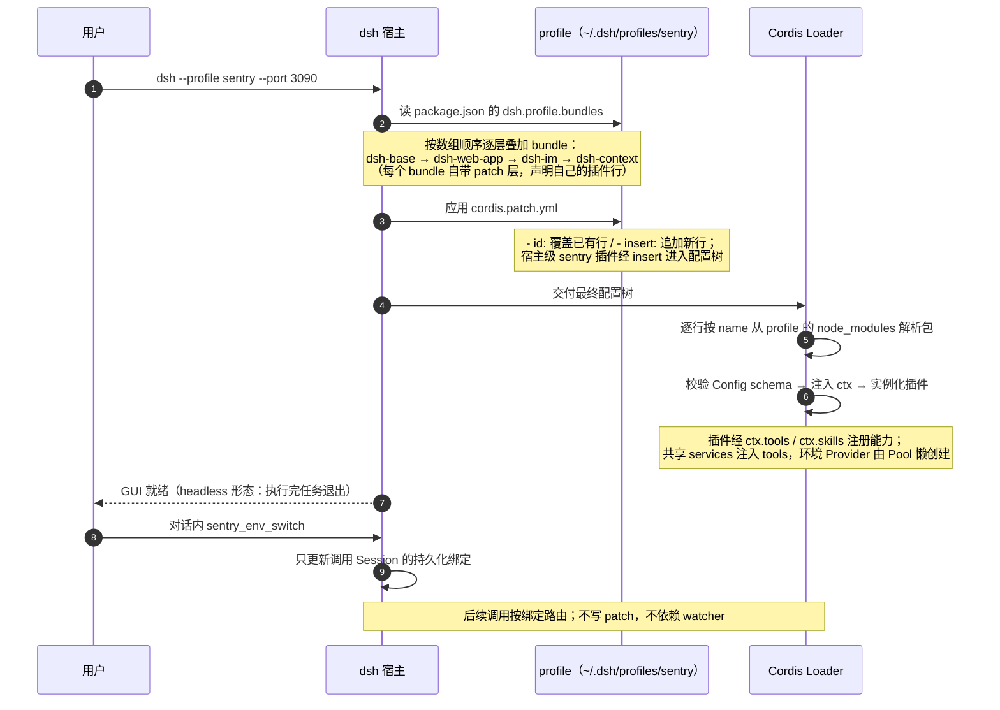

# dsh 宿主如何装配运行 dsh-sentry

> 状态：现行机制（本仓库实测口径，与官方 master 文档交叉核对）
> 配套：仓库侧装配线（envs.yml → 生成 → link）见 [overview.md](overview.md) 第 3 节；本文讲宿主侧的加载与运行机制

## 1. 装配模型：profile = bundle 基座 + patch 叠加

dsh 的装配单元是 **profile**（`~/.dsh/profiles/<name>`），它只认三样东西：

```text
~/.dsh/profiles/<name>/
├── package.json        # ① 插件依赖 + dsh.profile.bundles 数组（基座声明）
└── cordis.patch.yml    # ② 用户 patch 层（覆盖 / 追加）
                        # ③ 依赖解析自 node_modules——但宿主不扫描它（见下）
```

- **bundle** 是 profile 的基础插件组合。官方对 `@deepseek-ai/dsh-base` 的定义就是"every profile's first patch layer"——bundle 本质是一层预制的 patch，声明自己的插件行；profile 按 `dsh.profile.bundles` 数组顺序逐层叠加。sentry profile 的基座：`dsh-base`（基础能力）→ `dsh-web-app`（GUI）→ `@xmanrui/dsh-im`（IM 渠道）→ `dsh-context`（上下文洞察）。
- **patch 层**在 bundle 栈之上做用户修改：`- id: <行id>` 覆盖已有行、`- insert: [...]` 追加新行。**dsh-sentry 的宿主级工具、共享服务和 skills 通过 insert 加入；随环境切换的 Provider 由 Provider Pool 在运行时按 Session 绑定创建。**

一条铁律：**dsh 只按 bundles 列表与 patch 行装配，不扫描 node_modules**——只装依赖、名字不进装配清单，等于没装（[onboarding.md](../guides/onboarding.md) 排障表有实测案例）。

## 2. 启动装配时序



配置树里每一行的格式（官方 [插件 Config 指南](https://github.com/deepseek-ai/deepseek-harness/blob/master/docs/user/develop/basic/config.zh.md)的口径）：

```yaml
- id: sentry-env-binding    # 行 id：patch 覆盖的寻址键，profile 内唯一
  name: '@dsh-sentry/env-binding'   # npm 包名（或本地路径）
  config:                   # 用户配置，加载时按插件导出的 schema 校验、补默认值
    defaultEnv: tst-platform-hosted-0  # 新 Session 的默认环境，不是全局实时路由
```

预检：`dsh --profile sentry --dump-config | grep sentry-` 打印组合后的完整配置树（不启动服务），验证装配是否成功。

## 3. dsh-sentry 的两条注册路线

[apps/profile/package.json](../../apps/profile/package.json) 是被 dsh 消费的装配清单，两类插件注册方式不同：

| 类型 | 例子 | 注册方式 |
|---|---|---|
| 第三方（包声明 `dsh.bundle`） | `@xmanrui/dsh-im`、`dsh-context` | **双注册缺一不可**：依赖进 profile 包 + 包名进 `dsh.profile.bundles` 数组 |
| 自研（无 bundle manifest） | 全部 `@dsh-sentry/*` | 依赖 `workspace:*`；宿主级插件由装配线生成 patch 行 insert 进配置树，环境 Provider 由 Pool 动态装配 |

- 自研这条线的产物是两份生成文件（由 [envs.yml](../../apps/agent/envs.yml) 经 env-matrix 渲染，勿手改）：[cordis.patch.yml](../../apps/profile/cordis.patch.yml)（profile 原生 patch 格式，符号链接模式消费）与 [cordis.include.yml](../../apps/profile/cordis.include.yml)（条目清单格式，引入模式下由 `@deepseek-ai/cordis-plugin-include` 并入个人 profile 的 patch）。
- 宿主自带 `dsh plugin add`（装依赖 + 自动 reconcile bundles），但它在本 pnpm workspace 用不了：子目录执行被 workspace 强制 `-w`，依赖会装到仓库根——所以第三方注册才是"手动两步"（[onboarding.md](../guides/onboarding.md) SOP 节有实测记录）。

## 4. 接入形态

[scripts/link-profile.mjs](../../scripts/link-profile.mjs) 把 `apps/profile` 变成宿主可见的 profile，按目标状态自动判定两模式：**符号链接**（`~/.dsh/profiles/sentry` → 仓库 `apps/profile`，服务器与本地独立 profile；此时 profile 的 `node_modules` 就是仓库的，依赖已由仓库 `pnpm install` 就绪）与**引入**（本地开发机，个人 profile 保留，sentry 以 `link:` 依赖 + include 并入）。机制图与流程见 [overview.md](overview.md) 第 3 节。

## 5. 运行与热重载边界

哪些改动热生效、哪些必须重启（[runbook.md](../guides/runbook.md)）：

| 改动 | 生效方式 |
|---|---|
| patch 层（`cordis.patch.yml`：宿主插件 config、insert 行增删） | **watcher 热重载**。`use-env <env> -- --profile sentry` 只更新启动装配与默认环境，不重绑在线 Session；不要裸用默认的 web profile 目标 |
| Session 当前环境 | 对话内 `sentry_env_switch` 只更新当前 Session 的持久化绑定；不写 patch、不依赖 watcher，其他 Session 不变 |
| 代码根目录的环境变量 / 凭据库键 `DSH_SENTRY_CODE_BASE` | 重启宿主；由代码仓库服务构造期解析，无需 regenerate，也不进入装配 |
| 插件代码（`packages/` 源码） | 重启宿主（依赖 link 指向工作区，不用重装） |
| 依赖集合 / bundles 数组 / profile 的 package.json | 停进程 → `pnpm install` → 重启 |

铁律：**永远不要在 dsh 进程运行期间对仓库跑 `pnpm install`**——符号链接模式下 profile 的 `node_modules` 就是仓库的，运行中重装会卡死 patch 热重载（有事故记录）。

横切归属（profile 之外，各 profile 共享）：

- 模型：`$DSH_HOME/settings.yaml`，sentry 插件不引入自己的模型配置；
- 凭据：`$DSH_HOME/.credentials.yaml`，插件 config 里只写 `*Ref` 引用名（官方 [credentials 子系统文档](https://github.com/deepseek-ai/deepseek-harness/blob/master/docs/subsystems/credentials.zh.md)称这一层为 CredentialRef）；
- 会话：`~/.dsh/sessions`，headless 跑完退出后仍可回看。

## 6. 官方参照

宿主是开源项目 [deepseek-ai/deepseek-harness](https://github.com/deepseek-ai/deepseek-harness)（npm 包 `@deepseek-ai/dsh`，developer preview 阶段、官方自述会有 breaking changes——本文记录本仓库实测口径，机制演进以官方为准）：

| 主题 | 官方文档 |
|---|---|
| 项目 README（中文版） | [README.zh.md](https://github.com/deepseek-ai/deepseek-harness/blob/master/README.zh.md) |
| 文档站 | <https://deepseek-harness.github.io/deepseek-harness/> |
| Profile 管理、bundle 选择、热重载（HMR）协调 | [docs/subsystems/boot.zh.md](https://github.com/deepseek-ai/deepseek-harness/blob/master/docs/subsystems/boot.zh.md) |
| 插件 Config 定义、`- insert:` 条目格式、配置热替换 | [docs/user/develop/basic/config.zh.md](https://github.com/deepseek-ai/deepseek-harness/blob/master/docs/user/develop/basic/config.zh.md) |
| Cordis 插件体系入门（ctx、生命周期） | [docs/cordis-primer.zh.md](https://github.com/deepseek-ai/deepseek-harness/blob/master/docs/cordis-primer.zh.md) |
| CLI 参考（`--profile` / `--dump-config` / `plugin` 子命令） | [docs/cli-help.zh.md](https://github.com/deepseek-ai/deepseek-harness/blob/master/docs/cli-help.zh.md) |
| 凭据缝与 CredentialRef | [docs/subsystems/credentials.zh.md](https://github.com/deepseek-ai/deepseek-harness/blob/master/docs/subsystems/credentials.zh.md) |
| 动态扩展包与 inspector（`ctx.dynamicCordisRunner`、`cordisInspect`） | [docs/subsystems/extensions.md](https://github.com/deepseek-ai/deepseek-harness/blob/master/docs/subsystems/extensions.md) |
| 插件内 service 模式（对应本仓库 packages/services） | [docs/user/develop/framework/service.zh.md](https://github.com/deepseek-ai/deepseek-harness/blob/master/docs/user/develop/framework/service.zh.md) |
| 插件内 tool 开发（对应本仓库 packages/tools） | [docs/user/develop/basic/tool.zh.md](https://github.com/deepseek-ai/deepseek-harness/blob/master/docs/user/develop/basic/tool.zh.md) |
