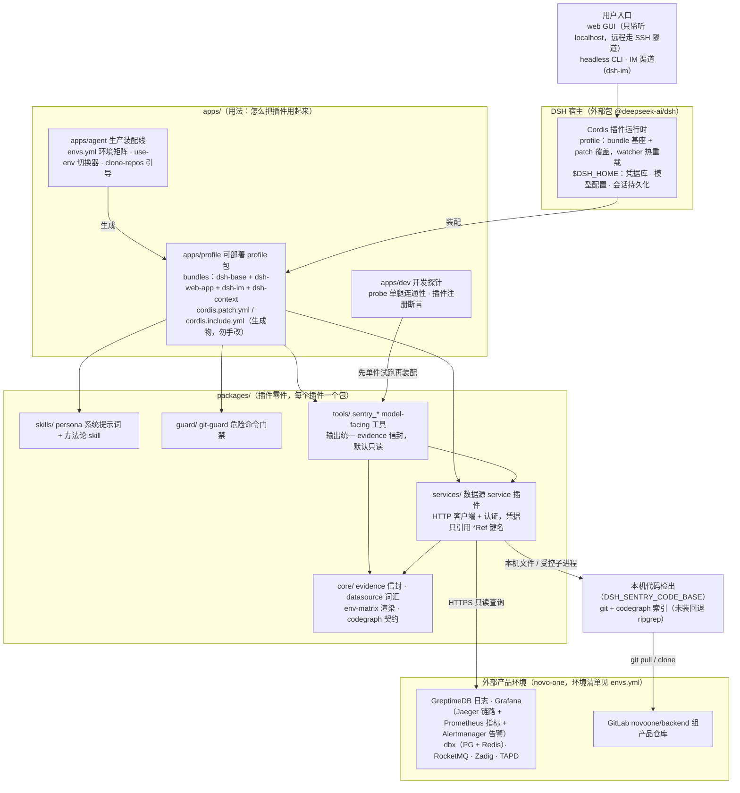
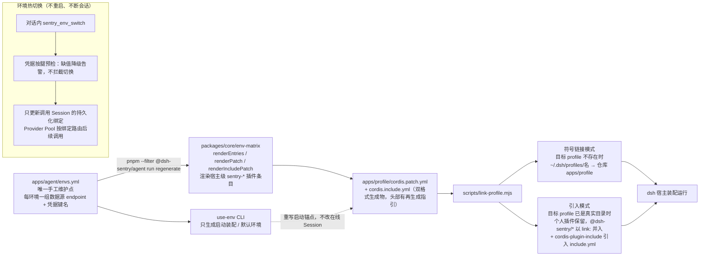
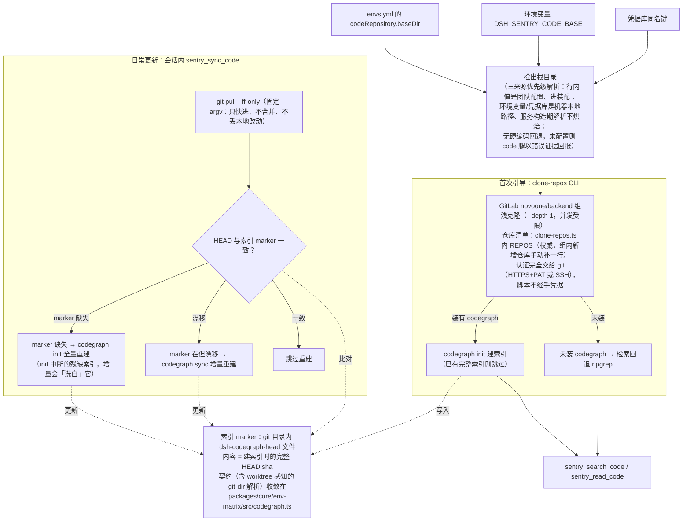

# 架构总览：dsh-sentry 与 dsh 的关系

> 状态：现行架构（结构演进时同步更新本文）
> 代码：本仓库全部；宿主是外部 npm 包 `@deepseek-ai/dsh`，不在本仓库

## 1. 定位与关系

dsh（deepseek-harness）是独立的 Agent 宿主运行时；dsh-sentry 是跑在它里面的 Cordis 插件集——通信产品 novo-commctl（novo-one）的 AIOps 故障调查员。**sentry 不调用、不监控 dsh，而是被 dsh 装配运行**；真正的调查对象是产品环境与代码仓库。

| 归属 | 内容 |
|---|---|
| dsh 宿主提供 | web GUI / headless CLI、profile（bundle + patch）机制与热重载、`$DSH_HOME` 凭据库、模型配置、会话持久化 |
| dsh-sentry 提供 | 证据腿 service + tool 插件、persona 与方法论 skill、git-guard 门禁、环境装配与部署管线 |
| 本仓库不提供 | 数据库、自带前端——查询目标是产品栈，GUI 由宿主 bundle 提供 |

命名辨析（"dsh-*" 在本仓库语境里有四种来源，别混淆）：

| 名字 | 是什么 |
|---|---|
| `@deepseek-ai/dsh-*` | 宿主运行时包（dsh-tools / dsh-skill / dsh-session…），全仓库统一 `^0.1.0-rc.7` 版本范围 |
| `@dsh-sentry/*` | 本仓库自研插件（`workspace:*`） |
| `@xmanrui/dsh-im`、`dsh-context` | 第三方 dsh 生态插件，经 profile 依赖引入 |
| `novo-*` | 被监控的产品后端仓库（GitLab `novoone/backend` 组），与 dsh 无关 |

## 2. 分层架构

各层职责一句话：

- **core**：插件共享地基——evidence 信封构建器、datasource Config 词汇与凭据引用解析、env-matrix 模型与渲染、codegraph 索引契约。
- **services**：每个数据源一个 service 插件，负责认证、响应校验与受控访问；HTTP 数据源凭据只接 `*Ref` 键名，不落值。代码仓库服务是本机文件与子进程传输的例外。
- **tools**：model-facing 的 `sentry_*` 工具，输出统一 `{ evidence: {...} }` 信封（错误同样以 confidence 0 的证据返回），**默认只读**。能力清单见 [README 能力全景](../../README.md#能力全景)。
- **skills**：persona（故障调查员行为宪法）+ 方法论 skill 集。
- **guard**：git-guard 对 bash 命令的双层门禁，详见[专题文档](git-guard.md)。
- **apps**：`agent` 是生产装配线（改环境、切环境、引导克隆只动这里），`dev` 是开发探针，`profile` 是可部署产物。apps 与 packages 的详细分工见 [README 目录结构](../../README.md#目录结构)。

## 3. 装配管线与环境热切换

要点：

- **envs.yml 是环境矩阵唯一权威**：每行环境 = 数据源 endpoint + 凭据键名（`*Ref`，值在本机 `~/.dsh/.credentials.yaml`）。环境清单与凭据键名以该文件为准，本文不复制。
- **生成物勿手改**：两份 cordis yml 头部都有再生成指引，修改入口只有 envs.yml。
- **接入两模式自动判定**：目标 profile 路径不存在 → 符号链接（服务器 / 本地独立 profile）；已是真实目录 → 引入模式（本地开发机，原 patch 自动备份为 `cordis.patch.yml.pre-sentry-core`）。
- **热切换原理**：`sentry_env_switch` 只更新调用 Session 的持久化绑定，Provider Pool 按绑定路由后续查询；不写共享装配文件、不依赖 watcher。`use-env` CLI 只设置新 Session 使用的启动默认环境，详见 [guides/env-switching.md](../guides/env-switching.md)。
- **宿主侧机制**（bundle 基座 + patch 叠加的加载时序、注册路线、热重载边界、官方文档参照）：见 [dsh-loading.md](dsh-loading.md)。

## 4. 代码检索闭环

代码腿（`sentry_search_code` / `sentry_read_code` / `sentry_sync_code`）建立在"本机一份产品仓库检出"之上：

要点：

- **根目录三来源优先级**：`envs.yml` 行内值 > 环境变量 > 凭据库；空值或纯空白视为未配置并继续回退，`~` 按当前用户展开（路径不是机密，凭据库只是“本机所有 dsh-sentry 可读配置”的统一落点）。显式配置 `repos` 或 `repoPath` 时服务尊重该发现方式，不再注入 `baseDir` 回退。
- **配置分层与生命周期**：行内值是团队配置，可由生成器写入装配；环境变量和凭据库是机器本地配置，仅在服务没有任何显式发现来源时由构造器解析，绝不进入生成物。修改机器配置后重启宿主生效，无需 regenerate；仓库发现仍在每次调用时执行，新增或移除检出不需要重启。服务器可用环境变量覆盖 scp 带来的旧凭据库路径——见 [guides/deploy.md](../guides/deploy.md)。
- **引导与日常分工**：clone-repos 只管首次（幂等可重跑，老检出缺索引会补建）；日常刷新由 `sentry_sync_code` 的 ff-only pull 负责。
- **marker 的意义**：`.codegraph` 目录非空且 marker 已落才算"完整索引"——init 中断留下的半成品会被识别并重试。重建按 marker 状态选命令：**缺失 → 全量 init**（残缺索引只有全量能补齐，增量会把半成品"洗白"）；**在但漂移 → 增量 sync**（常规刷新）。设计意图记录在代码注释（`sync.ts` 的 `healAction`、`codegraph.ts` 的契约说明）。

## 5. 运行时拓扑与部署形态

三个用户入口共享同一套凭据库与模型配置（`$DSH_HOME` 级）；但 **profile 不尽相同**——web/IM 走 sentry 装配，headless 是独立的最小 profile：

| 入口 | 形态 | 说明 |
|---|---|---|
| web GUI | `dsh --profile sentry --port 3090` | 无认证层，**只监听 localhost**，远程访问走 SSH 隧道；服务器常驻用 systemd（见下） |
| headless | `dsh --profile headless --patch <patch.yml> "任务"` | 一次性任务，跑完自动退出；`headless` 是按 [runbook.md](../guides/runbook.md) 手工搭建的**独立最小 profile**（只装了当时所需的少量插件 + 手写 patch），**不是 sentry 全量装配**——任务里缺某工具先查它的插件列表；会话持久化在 `~/.dsh/sessions` 可回看 |
| IM | dsh-im（profile 内置第三方插件） | 飞书等 IM 机器人接入；每个聊天持久维护到 Harness 会话的映射（默认复用），`/new` 清映射、`/workspace` 切工作区——见 [guides/dsh-im.md](../guides/dsh-im.md) |

服务器常驻（systemd）要点，完整步骤见 [guides/deploy.md](../guides/deploy.md)：

- `ExecStart=dsh --profile sentry --port 3090`，`Restart=always` + `RestartSec=5`；`After=network-online.target`（证据腿全是 HTTPS 出网调用）。
- `User` 必须是部署用户、`DSH_HOME` 显式指向其 `~/.dsh`——凭据在那里，跑成 root 读不到。
- node 装在 nvm 等用户级目录时，`ExecStart` 改用显式 node 路径调 dsh 的 bin.js。
- 日常更新：`systemctl stop` → `git pull` → `pnpm install` →（envs.yml 有变时 `regenerate`）→ `start`。**顺序不能乱**：进程运行期间在 profile 目录跑 pnpm install 会卡死 patch 热重载。

横切归属：

- **凭据**：全部 token/账密在 `$DSH_HOME/.credentials.yaml`，本仓库只出现 `*Ref` 键名（见 [guides/credentials.md](../guides/credentials.md)）。
- **模型**：`$DSH_HOME/settings.yaml` 全局配置，插件与 profile 不自带模型。

## 6. 相关文档

| 主题 | 入口 |
|---|---|
| git-guard 双层门禁 | [architecture/git-guard.md](git-guard.md) |
| 启动与挂载（headless / web GUI） | [guides/runbook.md](../guides/runbook.md) |
| 新同事从零接入 | [guides/onboarding.md](../guides/onboarding.md) |
| 服务器部署与 systemd 常驻 | [guides/deploy.md](../guides/deploy.md) |
| 多环境热切换 | [guides/env-switching.md](../guides/env-switching.md) |
| 凭据管理 | [guides/credentials.md](../guides/credentials.md) |
| IM 渠道（dsh-im） | [guides/dsh-im.md](../guides/dsh-im.md) |
| TAPD 对接档案 | [integrations/tapd-integration.md](../integrations/tapd-integration.md) |
| 环境矩阵（权威数据源） | `apps/agent/envs.yml` |
| 产品背景与服务清单 | `packages/skills/sentry-skills/skills/project-context/SKILL.md` |
