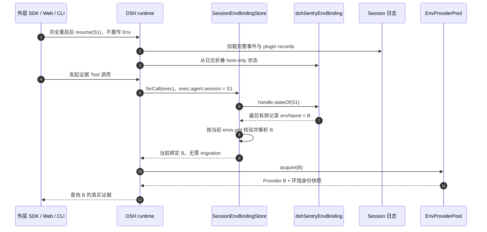
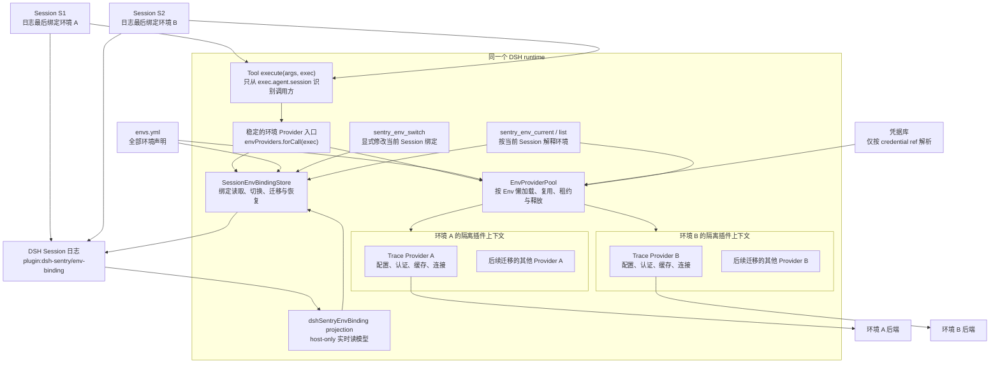
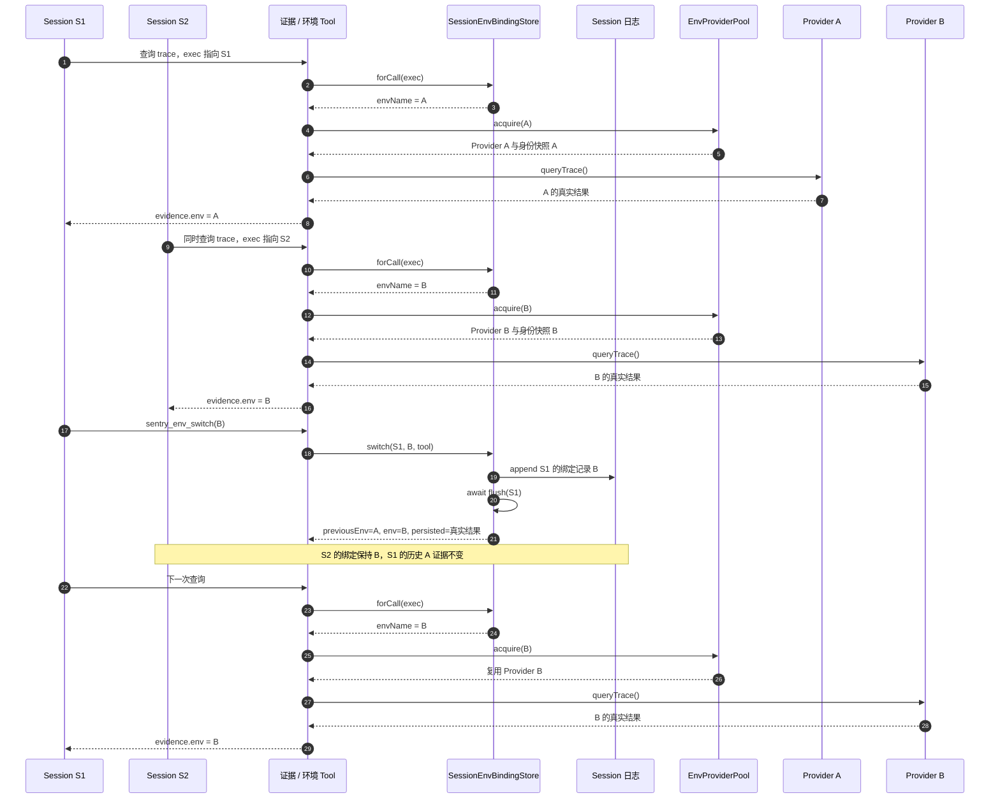
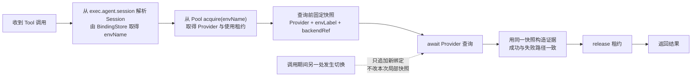

# Session 级环境绑定、持久化与 Provider 池方案

> 状态：Session 绑定、Provider 池与全部证据腿路由已实施并通过真实组件探针；web 宿主接线（组装条目）已生成，待 web 端验收 · 2026-10-27  
> 目标宿主：DSH `v0.2.1-rc.3`  
> 当前实现：`env-binding`、`EnvProviderPool` 与 8 个证据 Tool 的 Session 路由已落地；`regenerate` 组装已包含 env-binding/env-provider 宿主条目（legacy 全局装配条目保留为回退路径，验收后删除）；`pnpm --filter @dsh-sentry/dev run probe:session-env` 通过（双 Session 并发、fork、compact、跨进程 resume 恢复）  
> 替代关系：本文取代 `skills-refactor-plan.md` 中“profile 级共享 Env”的运行时语义；Definition / Provider / Consumer 与 Skills 迁移方向不变

## 1. 结论

目标是让**一个 DSH runtime 同时服务多个处于不同环境的 Session**，并在进程重启、Session 恢复和 fork 后保留正确的环境路由：

- Session S1 查询环境 A 时，Session S2 可以同时查询环境 B。
- S1 从 A 切到 B，只改变 S1 后续调用的路由，不改变 S2。
- 切换不重启 runtime，不新建、清空、fork 或压缩 Session。
- 已写入历史的证据保持原样；进行中的调用仍归属于它实际使用的 Provider。
- 同一环境的多个 Session 共享该环境的 Provider、连接和认证缓存，不为每个 Session 重建客户端。
- runtime 完全退出后再 resume，同一 Session 不需要外层 SDK 重传 Env，也能恢复最后一次有效绑定。

实现这一点需要三个独立机制：

1. **Session 到 Env 的持久绑定**：`plugin:dsh-sentry/env-binding` 是追加到 DSH Session 日志的持久事实。
2. **绑定的实时读模型**：host-only projection `dshSentryEnvBinding` 折叠日志，为当前进程提供同步读取；内存 Map 不作为恢复依据。
3. **按 Env 隔离并复用的 Provider 池**：同一 runtime 可以同时持有 A/B 多套 Provider，而不是重写共享装配后只保留一个全局实例。

这里的“Session 与 Env 解耦”是指会话历史与后端运行配置解耦，不表示调用不需要路由。Session 日志只保存 canonical 环境名和少量审计元数据；endpoint、credential ref、凭据值、Provider 客户端和认证 cookie 都不进入绑定记录。

本文选择 **plugin record + projection**，不采用自定义正式 `SessionEventMap` 事件，也不引入 `dsh-storage-domain` KV 副本。plugin record 已提供 `ignorable: true`、随 resume/fork 携带和不进入模型可见消息面的语义，无须修改正式 Session 格式。KV 或 BFF 数据库可以保存用户、conversation 与 DSH Session 的产品关系，但不再复制一份 Env 绑定事实。

## 2. 旧全局链路与待迁移问题

除已接入 Session Provider 路由的 Redis 外，其余正式证据链路仍是 runtime 全局切换：

1. `sentry_env_switch` 调用 `switchEnvironment()`，重写生成的 `cordis.patch.yml`、`cordis.include.yml`，并可能同步写真实 profile patch。
2. DSH watcher 根据共享装配文件重建 Provider。
3. Tool 通过 `ctx.traceStore`、`ctx.logStore` 等 Cordis 插槽取得当前单例 Provider。
4. 因而同一 runtime 中的所有 Session 最终都会走到当前装配的环境。

证据还有独立的一致性问题：多个 Tool 使用 `liveAssemblyEnv()` 读取文件标签，而查询由 Provider 执行。文件标签和 Provider 实例不是同一个原子快照，切换竞态下可能把 A 的数据标成 B。trace Tool 当前还把执行上下文命名为 `_exec` 并忽略它，无法按调用方路由。

所以，当前架构支持“全局热切换”，不支持“Session 级环境隔离”。仅在内存增加 `sessionId → envName` 也不完整：进程重启后 Map 丢失，所有 Session 会回到默认环境；只增加标签而没有 Provider 池，底层查询仍会串环境。

## 3. 目标语义与状态归属

| 状态 | 所有者 | 生命周期与约束 |
|---|---|---|
| DSH Session 历史 | DSH | 保存消息、工具调用、工具结果和绑定记录；环境切换不改写旧历史 |
| Session 环境绑定事实 | Session 日志中的 `plugin:dsh-sentry/env-binding` | 追加式保存；最后一条 schema 有效记录生效；resume/fork/导出随日志携带 |
| Session 环境绑定读模型 | `SessionEnvBindingStore` 注册的 `dshSentryEnvBinding` projection | host-only、按当前日志游标增量折叠；不是独立事实来源 |
| 环境矩阵 | `apps/agent/envs.yml` | 静态声明可用环境、endpoint 和 credential ref；仍是唯一手工维护点 |
| Provider 实例 | `EnvProviderPool` | 按 Env 懒创建、复用和释放；同一 runtime 可同时存在 A/B 多套实例 |
| 后端认证 session | 各 Env 的 Provider | 保存 cookie、过期时间、连接和 timer；与同 Env 的 Provider 一起释放 |
| 证据环境身份 | 单次 Tool 调用的局部快照 | 查询前从实际 Provider 固定 `envLabel` 与 `backendRef`，写入后不可变 |
| runtime 默认 Env | 启动配置 | 仅用于新 Session 未显式指定 Env，或旧 Session 无记录/记录失效时的恢复；不覆盖已有有效绑定 |
| 用户、conversation、DSH Session 的关系 | 外层 BFF / 产品服务 | 负责鉴权、用户隔离和会话查询；不另建 Env 绑定副本 |

“当前环境”此后默认指**当前 Session 的绑定环境**。runtime 不再有唯一的全局 active Env；它只有默认 Env、多个 Session 绑定，以及多个已加载的 Env Provider。

## 4. 持久化契约

### 4.1 记录类型与 payload

新增包 `@dsh-sentry/env-binding`，拥有记录类型：

```text
plugin:dsh-sentry/env-binding
```

payload 固定为：

```ts
type EnvBindingRecord = {
  v: 1
  envName: string
  changedAt: string
  source: 'tool' | 'sdk' | 'default' | 'migration' | 'recovery'
}
```

约束如下：

- `v` 是 payload 版本；首版只接受字面量 `1`。
- `envName` 只写 `envs.yml` 中的 canonical 名称。调用方可以传别名，但写入前必须解析为 canonical 名称。
- `changedAt` 是 ISO 8601 UTC 时间，用于审计和展示，不参与“哪条记录生效”的判断；生效顺序只由 Session 日志顺序决定。
- `source` 区分显式 Tool 切换、外层 SDK 初始化、默认初始化、旧 Session 迁移和失效绑定恢复。
- payload 不包含 endpoint、datasource uid、credential ref、token、cookie、Provider 配置或用户信息。
- 写路径通过 `PluginRecordMap` declaration merging 获得类型检查；读回时 `pluginRecordOf(event).data` 始终按 `unknown` 处理，再用 zod schema 校验，不能信任声明类型代替运行时校验。

最后一条 **schema 有效** 的绑定记录生效。schema 无效或不属于本 owner 的记录不改变 projection 状态。若最后一条有效记录中的环境已从当前矩阵移除，则进入第 5.3 节的失效恢复流程，不回退到更早的历史环境，避免意外复活已退役环境。

### 4.2 projection 读模型

`dshSentryEnvBinding` 使用 `ProjectionDefinition`：

- `stateVersion: 1`。
- 不声明 `wire`，因此是 host-only projection，不进入客户端 projection snapshot 或 Session summary。
- `init()` 返回“无绑定”状态。
- `apply()` 对每个传入事件调用 `pluginRecordOf(event)`；只处理匹配的记录类型和通过 schema 校验的 payload。
- projection 必须折叠完整日志，包括 fork 的继承前缀，不能只处理 `inheritedEventCount` 之后的子 Session 自有事件。
- projection 状态只保存当前记录的必要元数据和日志位置；无记录时返回空状态，不在这里读取 `envs.yml`、解析凭据或执行异步 I/O。

`SessionEnvBindingStore` 作为 Cordis Service 安装时注册 projection，注册生命周期跟随插件 fiber，插件卸载时释放注册。当前绑定通过 **`ctx.sessionProjections.stateOf(session, key)`** 读取；这是目标版本 `v0.2.1-rc.3` 的实际公开 API（`register()` 同步返回注销函数，不返回异步 registration handle）。

projection 是日志的派生读模型，不是第二份需要人工同步的数据。实现可以依赖 DSH projection 的增量物化与缓存，但禁止再用一个业务 Map 作为重启恢复依据。

### 4.3 写入与持久化确认

显式切换按以下顺序执行：

```text
解析 Session → 校验目标名称/别名与逐腿 readiness → appendPluginRecord()
→ projection 已反映新绑定 → await ctx.sessions.flush(session) → 返回真实 persisted
```

语义必须区分“本进程已生效”和“已确认落盘”：

- `appendPluginRecord()` 同步成功后，新绑定在本进程生效，后续调用使用新 Env；append 不等待持久化后端。
- `ctx.sessions.flush(session)` 返回 `true`，才表示至少一个 durability listener 参与且全部成功，可返回 `persisted: true`。
- `flush()` 返回 `false`，表示没有 durability listener；绑定已在本进程生效，但必须返回 `persisted: false`，并明确“持久化未确认”。
- `flush()` 抛错时，不撤销已经追加的日志记录，也不把投影回滚成旧 Env；返回或抛出包含 `persisted: false` 的可识别结果，调用方可以据此告警或重试 durability checkpoint。
- append 失败时记录未进入日志，原绑定保持不变；不能继续执行成功响应或伪装已经切换。
- 不以“文件写入已调用”“watcher 已触发”或“Provider 已创建”代替 Session 持久化确认。

由于 append 后、flush 前存在进程崩溃窗口，`persisted: true` 只对当次成功 checkpoint 负责，不承诺任意后续故障下绝无数据丢失。

### 4.4 DSH owner 策略前置条件

DSH 当前源码对 plugin record 有如下限制：

- `appendPluginRecord()` 的生产调用方在 Harness 仓库内只允许位于 `packages/experimental/`。
- `verify-plugin-record-callers` gate 只扫描 Harness 仓库，无法直接拒绝 dsh-sentry 的仓库外调用。
- 但 `packages/core/session/README.md` 同时明确写了仓库外插件也不应调用，因此“扫描不到”不等于契约允许。

实施绑定包之前，必须先在 Harness 仓库完成一个最小策略改动：

1. 在 `packages/core/session/README.md` 及中文对应文档中明确认可 `@dsh-sentry/env-binding` 作为 `plugin:dsh-sentry/env-binding` 的仓库外 owner，并登记 payload 与“记录丢失时允许回退默认环境”的语义。
2. `docs/experimental-persistence-catalog.md` 是 Harness 仓库内声明的生成目录，外部 owner 的契约由 dsh-sentry 自己维护，不手改该文件，也不为它扩展生成器。
3. 不修改 `SessionEventMap`、`KNOWN_SESSION_EVENT_TYPES`、Session 格式版本、SDK 快照、persistence codec 或 caller gate。

这是 owner 策略认可，不是绕过 gate。dsh-sentry 自身仍须通过代码评审和测试约束记录名称、payload 与写路径。

### 4.5 禁止使用的读取方式

新实现通过 projection 和 `pluginRecordOf()` 重建状态，不新增以下 deprecated Session 读取 API 的调用：

- `snapshotEvents()`
- `eventAt()`
- `ownEvents()`

测试需要观察追加事件时，通过真实 `SessionStore` 的 `session/event` feed 收集；恢复测试通过 seed / restore 构造第二个真实 Session，不用 deprecated API 绕过目标读模型。

## 5. 创建、恢复与生命周期语义

### 5.1 统一规则

| Session 场景 | 环境绑定行为 |
|---|---|
| 新建，SDK 显式传 Env | 校验后写 `source: 'sdk'` 记录 |
| 新建，未传 Env | 绑定 runtime 默认 Env，写 `source: 'default'` 记录 |
| 同进程再次使用已有 Session | 读取 projection 中已有绑定；外层每次请求不得用启动 Env 覆盖它 |
| 进程重启后 resume，有有效记录 | 从完整日志折叠恢复最后绑定，不要求 SDK 重传 Env |
| resume / 旧 Session 无记录 | 使用 runtime 默认 Env，补写一条 `source: 'migration'` 记录 |
| 最后有效记录指向已移除 Env | 回退 runtime 默认 Env，补写 `source: 'recovery'` 记录，并报告恢复原因 |
| fork | 继承 fork 点之前最后一条有效绑定；之后父子 Session 独立切换 |
| compact / 历史压缩 | 原始日志与绑定不变；不依赖模型可见消息推导 Env |
| JSONL 导出后恢复 | 导出记录被保留时恢复原绑定；记录缺失时按无记录迁移，不伪造原环境 |
| 删除 / dispose | 不另存 KV 或内存事实，因此没有孤儿绑定表；Provider 是否释放由 Pool 的租约和空闲策略决定 |

已有 Session 上需要改变 Env 时，必须显式调用同一个 `SessionEnvBindingStore.switch()`。外层 SDK 不能在每次 prompt、resume 或Tool调用时隐式重传并覆盖绑定，否则模型通过 `sentry_env_switch` 做出的变更会被下一次请求冲掉。

DSH 对 plugin record 的格式迁移保留语义是 best-effort。若记录确实丢失，允许回退默认 Env，但必须写 `migration` 记录并暴露恢复来源；这与“重启后正常情况下自动恢复最后绑定”不矛盾。

### 5.2 无记录迁移与并发

`current(session)` 不只读 projection，还要按当前 `envs.yml` 解析绑定并处理无记录/失效恢复：

1. 从 registration handle 取得当前状态。
2. 有有效记录且 Env 仍存在：返回 canonical Env，不写日志。
3. 无有效记录：解析默认 Env，追加 `migration` 记录并执行持久化确认。
4. 记录中的 Env 已失效：解析默认 Env，追加 `recovery` 记录并执行持久化确认。
5. 默认 Env 本身未配置或不可用：返回明确配置错误，不任意选择矩阵第一项，也不写指向未知环境的记录。

首次恢复按 Session 做 single-flight：同一个 Session 的并发 `current()` 只产生一条迁移或恢复记录，其他调用等待同一结果。显式切换与恢复写入必须按 Session 串行协调，避免恢复写入覆盖一次已完成的显式切换。

并发显式切换不做跨 Session 全局锁；同一 Session 按日志 append 顺序 last-record-wins，不同 Session 互不影响。Tool 结果中的 `previousEnv` 和 `env` 必须对应该次实际提交的转换，不能仅根据调用开始前的过期快照编造成功结果。

### 5.3 恢复时序



## 6. 目标架构



### 6.1 `SessionEnvBindingStore`

建议稳定接口如下，具体 TypeScript 类型可在实现时细化，但职责不变：

```ts
interface SessionEnvBindingStore {
  initialize(session: Session, input?: { env?: string }): Promise<ResolvedEnvBinding>
  current(session: Session): Promise<ResolvedEnvBinding>
  switch(
    session: Session,
    input: { env: string; dryRun?: boolean },
    source: 'tool' | 'sdk',
  ): Promise<EnvSwitchResult>
  forCall(exec: ToolExecutionContext): Promise<ResolvedEnvBinding>
}
```

- 通过 `ctx.plugin(SessionEnvBindingStore, config)` 安装并注册 projection，随插件 fiber 释放；目标版本通过 `ctx.sessionProjections.stateOf(session, key)` 读取。
- `initialize(session, input)` 只初始化没有绑定的新 Session，已有绑定不被外层启动配置覆盖。
- `current(session)` 返回解析后的绑定、来源和逐腿 readiness，负责无记录迁移与失效恢复。
- `switch(session, input, source)` 复用 `env-matrix` 的名称/别名和凭据 readiness 校验，执行“校验 → append → flush”。
- `forCall(exec)` **只通过 `exec.agent?.session`** 解析调用 Session，供 Router 和 Provider facade 使用；无法解析时明确报错。
- 包入口只导出稳定接口，隔离 DSH record/projection 的读回细节。

`dryRun` 只校验目标和 readiness，不 append、不 flush、不改变绑定。

### 6.2 `EnvProviderPool`

Pool 负责 Env 级资源生命周期。由于现有 Service 在一个 Cordis Context 中占用命名单例插槽，不能把多个 Env 的同名 Service 都注册到根 Context。每个 Env 应拥有隔离的子插件上下文或 fiber，在其中按该 Env 配置加载 Provider 集；池向外提供稳定的类型化 Provider bundle。

稳定的环境 Provider 入口组合 BindingStore 与 Pool，供 Tool 使用。已落地的入口命名为 `envProviders`：Redis Tool 通过 `envProviders.forCall(exec)` 获取本次调用的租用 Provider，并在成功或失败后释放租约。`@dsh-sentry/service-env-provider` 拥有 Pool 和 DBX 环境适配，避免 core 包反向依赖具体 Provider。

### 6.3 配置和凭据

`envs.yml` 与凭据库继续作为配置来源。会话切换只选择矩阵中已有的名称或别名，不能接受任意 endpoint，也不能把凭据值复制进绑定、日志、证据或 Session。BindingStore 每次解析当前绑定时按最新矩阵校验 Env；Provider Pool 按配置版本管理实例，不把矩阵内容快照进 plugin record。

## 7. 双 Session 并发与切换时序



S1 切换后，A 的 Provider 不应仅因为 S1 离开就立即销毁：它可能仍被其他 Session 使用，也可能还有进行中的调用。Pool 根据使用租约和空闲策略决定后续释放。

## 8. 单次调用的一致性

每次 Tool 调用必须先固定路由、Provider 和证据身份，再执行异步查询：



约束如下：

- 证据中的 `env` 来自本次实际 Provider 的 `envLabel`，不再来自 `liveAssemblyEnv()`。
- `backendRef`、endpoint 展示值和 refs 必须来自同一个 Provider 快照。
- 查询进行中发生切换，本次结果仍标旧 Env；下一次调用才按新绑定路由。
- 错误路径也使用同一快照。若 Provider 根本未取得，不得用目标 Env 冒充实际连接 Env；可另报 `requestedEnv`，实际 `env` 应为 `unknown` 或不可用。
- 不把一次调用拆到两个 Provider 上盲目重试并拼接结果；重试继续遵循既有超时和只读策略。

## 9. Tool 与外部 SDK 契约

### 9.1 为什么保留 `sentry_env_switch` 为模型可见 Tool

`sentry_env_switch` 表示一次**显式、可审计的 Session 级路由变更**。保留 Tool 有三个好处：

- 模型可以在调查过程中主动切换环境，调用和结果按正常 Tool 历史进入会话，便于审计和追溯。
- 普通证据 Tool 无需暴露 `env` 参数，避免每次查询绕过 Session 绑定或任意选择后端。
- 切换结果可以明确返回原环境、新环境、降级腿和持久化状态。

plugin record 本身不进入模型可见消息面；可见审计信息来自 Tool 调用与 Tool 结果，不要求把内部路由记录暴露给模型。

### 9.2 三个环境 Tool

| 工具 | 目标行为 |
|---|---|
| `sentry_env_list` | 继续列出矩阵、别名和逐腿凭据就绪度；“当前项”按 `exec.agent.session` 的绑定解释 |
| `sentry_env_current` | 返回当前 Session 恢复后的绑定、来源和逐腿 Provider 状态；不再用共享 patch 文件代表所有 Session |
| `sentry_env_switch` | 校验名称与 readiness 后，只更新当前 Session 绑定；不写共享 patch/include，不等待全局 watcher |
| 其他 `sentry_*` 证据工具 | 使用 `exec` 取得当前 Session 对应 Provider；不新增 `env` 参数，统一证据信封保持稳定 |

`switch` 参数保持简单：

```ts
{
  env: string       // envs.yml canonical 名称或已有别名
  dryRun?: boolean  // 默认 false；只校验，不写记录
}
```

参数不接受 endpoint、credential ref、凭据值或任意文件路径。

非 `dryRun` 成功结果至少包含：

```ts
{
  ok: true
  previousEnv: string
  env: string
  dryRun: false
  persisted: boolean
  degradedLegs: Array<{ leg: string; missingRefs: string[] }>
}
```

还可增加 `changedAt`、`source` 和不含敏感值的 `persistenceError`。`dryRun` 结果返回解析后的目标 Env 和 `degradedLegs`，不包含共享装配 patch，也不把 `persisted` 描述为已写入。旧版 `writtenPaths`、渲染 patch 和 `hotReloadPending` 属于全局装配实现细节，迁移时需要记录兼容性差异，不能保留为空壳字段误导调用方。

### 9.3 外部 SDK、BFF 与其他客户端

外层 SDK 可以复用 `SessionEnvBindingStore` 创建初始绑定和显式切换，但不另建状态来源：

- 创建 Session 时可传初始 Env；未传则走默认初始化。
- resume 已有 Session 时以日志绑定为准，不要求重传 Env。
- 修改已有 Session 的 Env 必须调用显式 switch，不能在每次请求中隐式覆盖。
- BFF 可以保存 `userId / conversationId / dshSessionId`、鉴权和产品审计；这些记录用于找到 Session，不复制 Env 绑定。
- CLI、Web、公司排障平台和 headless SDK 都通过同一 Session/Tool 路由边界，不分别维护内存环境变量。

## 10. Provider 池生命周期

1. **懒加载**：第一次有调用绑定到某 Env 时创建该 Env 的隔离插件上下文，不为所有矩阵环境预先建立全部连接。
2. **按 Env 复用**：S1、S2 都使用 B 时共享 Provider B、认证 cookie、连接与缓存，不按 Session 复制资源。
3. **按调用租用**：`acquire` / `release` 界定进行中的调用，避免释放仍在使用的客户端。
4. **切换不销毁旧实例**：Session 重绑定只追加路由记录。旧 Env 可在无引用后按空闲策略回收，runtime 关闭时必须完整释放。
5. **配置变更新建代际**：同一 Env 的 endpoint 或凭据配置变化时，以配置版本创建新 Provider 代际；旧调用继续完成，旧代际排空后释放，不能原地修改正在使用的配置。
6. **环境无关能力不强行复制**：TAPD、代码仓库等不随 Env 切换的能力可以保留共享 Service，不为了形式统一进入每 Env 池。

当前 Pool 已装配全部七条 Provider 腿（DBX→cache/db、GreptimeDB→logs/callflow、trace、prometheus→metrics、alertmanager、rocketmq→MQ、zadig），8 个证据 Tool 全部通过 `envProviders.forCall(exec)` 走 Session 路由（无该服务的宿主回退全局装配）；TAPD、代码仓库等环境无关能力保留共享 Service。共享传输的 Provider 在同一个 Env 上下文内继续共享。每个隔离服务名使用独立 label；Cordis 按 label 注册 Provider，同一 Env 的 `cacheStore` 与 `dbStore` 不能共用同一个 label。

## 11. 失败与降级语义

- 未知名称或别名：拒绝切换，保留原绑定，不 append。
- 缺少某腿凭据：沿用现有按腿降级，不影响其他腿；返回 `degradedLegs` 和缺失 ref 键名，不泄漏凭据值。
- 无法从 `exec.agent?.session` 解析 Session：返回明确的路由错误，不能偷偷使用“最后一个全局 Env”。
- 默认 Env 未配置或已从矩阵移除：恢复失败并报告配置错误，不任意选择其他 Env。
- 绑定记录 schema 无效：忽略该记录；无其他有效记录时按迁移处理，并记录可诊断日志。
- 绑定记录存在但 Env 已失效：回退默认 Env 并写 `recovery`，不自动使用更早的历史 Env。
- Provider 创建失败：报告当前 Session 目标 Env 和失败腿，不把其他 Session 的可用 Provider 当作替代后端。
- 单腿 Provider 不可用：其他腿继续工作；`sentry_env_current` 返回逐腿状态，不虚构全局一致状态。
- Provider 暂时失败：沿用现有结构化错误、认证重试和只读超时策略，不因失败自动切换到别的 Env。
- append 失败：绑定未改变；flush 无 listener 或失败：绑定已改变但未确认持久化。两种结果必须可区分。

## 12. DSH 接入约束与真实宿主探针

已确定的入口是 Tool 的公开 `execute(args, exec)` 上下文，不能继续忽略为 `_exec`。绑定只从 `exec.agent?.session` 获取，不扫描历史事件、不猜测最后一个 Session，也不把 AsyncLocalStorage 当作绑定事实来源。AsyncLocalStorage 最多用于内部传递已经确认的调用上下文。

实现 Provider 接入前，需要在真实 DSH `v0.2.1-rc.3` base bundle 做最小探针，确认：

1. `exec.agent` 在当前分包组合中的运行时形状与类型声明一致，`exec.agent.session` 是稳定的 live Session。
2. create、resume、fork 后，Tool 看到的 Session 对象和 ID 与调用方一致。
3. web、headless 与外部 SDK 三种入口都经过同一执行上下文。
4. Tool 异步执行期间，该上下文仍指向原调用的 Session，不被另一个并发调用覆盖。
5. 切换并 flush、完全退出进程、resume 后，不重传 Env 仍恢复最后绑定。
6. fork、compact、JSONL 导出恢复保留本文定义的绑定语义。

如果公开 API 没有这条解析链，应先修正依赖版本或在 DSH 增加公开只读 Session routing context；不能退回文件标签、全局变量或私有历史扫描。

## 13. 分阶段实施

实施顺序固定为：**绑定包与测试 → 真实宿主探针 → Router/Provider 接入 → 证据 Tool 与环境 Tool 同步切换 → 删除旧全局路径**。

### 阶段 0：文档与 owner 认可

1. 本文先固定持久化、Tool、恢复和验收契约。
2. 在 Harness 仓库的中英文 Session README 登记外部 plugin record owner 与恢复策略，不修改生成的 persistence catalog 或运行时代码。
3. 确认 dsh-sentry 对 DSH `v0.2.1-rc.3` 的依赖解析与公开类型一致。

### 阶段 1：新建 `@dsh-sentry/env-binding`

新增 `packages/core/env-binding`：

- `src/record.ts`：zod schema、payload 类型和 `PluginRecordMap` declaration merging。
- `src/projection.ts`：`stateVersion: 1` 的 host-only `ProjectionDefinition`，用 `pluginRecordOf(event)` 折叠完整日志。
- `src/store.ts`：实现 `SessionEnvBindingStore`，封装注册、当前绑定、显式切换、恢复 single-flight 和 `forCall(exec)`。
- `src/index.ts`：只导出稳定接口，隔离 DSH 读回细节。
- `tests/`：使用真实 `SessionStore` 和 `SessionProjectionRegistry`，通过 `session/event` 收集测试事件。

这一阶段不提前改变证据 Tool 的生产路由。

### 阶段 2：绑定测试与真实宿主验收

先完成第 14.1 节的包级测试，再在真实 DSH `v0.2.1-rc.3` base bundle 验证：

```text
切换并确认 flush → 完全退出进程 → resume 同一 Session
→ 不重传 Env → current / 证据调用仍恢复原环境
```

随后验证 fork、compact、JSONL 导出恢复，以及 web/headless/外部 SDK 的 `exec.agent.session` 身份一致性。真实宿主不通过时，先修正接入边界，不继续堆叠 Provider 改造。

### 阶段 3：DBX/Redis 纵向闭环

实现 BindingStore 与 Provider facade 的组合、EnvProviderPool 和 DBX 的隔离 Cordis 上下文，先迁移 Redis 证据路径。保留现有登录刷新、连接发现、认证重试、超时和释放行为；DB Tool 可在同一 Pool 能力上后续接入。

环境切换仍复用 `@dsh-sentry/env-matrix` 的名称/别名与 readiness 校验逻辑，不复用会写共享文件的 `switchEnvironment()`。

### 阶段 4：证据 Tool 与环境 Tool 同步切换

必须在**证据 Tool 已能通过绑定取得对应 Env Provider 的同一个 PR** 中修改三个环境 Tool：

- `sentry_env_switch` 只修改 `exec.agent.session` 的绑定，不写共享 patch/include。
- `sentry_env_current` 报告当前 Session 的恢复后绑定及逐腿 readiness。
- `sentry_env_list` 继续列矩阵，“当前项”按调用 Session 解释。

在证据 Tool 尚未按绑定路由前，不提前删除旧全局切换，避免出现“绑定显示 B、实际查询仍是 A”。同样，不能只迁移 `switch` 而让 `current/list` 继续读取共享文件。

### 阶段 5：证据身份、其他证据腿与旧路径删除

1. 删除 trace Tool 对 `liveAssemblyEnv()` 和启动时 Env 配置的依赖，固定单次调用快照。
2. 补充“A 查询延迟返回期间 S1 切到 B”的测试，断言进行中的结果仍为 A，下一次结果才为 B。
3. 按 logs/callflow → trace → metrics/alerts → MQ/Zadig 的顺序接入 Pool；环境无关能力单独说明。
4. 所有依赖 Session 绑定的证据路径完成迁移后，再删除旧全局 patch/include 切换路径。
5. 明确 CLI `use-env` 的过渡语义：它可设置启动装配或 runtime 默认 Env，但不覆盖某个在线 Session 的已有绑定。
6. 最后更新使用指南、env-switcher skill 和重构总计划，移除“profile 级共享 Env”的旧说明。

## 14. 测试与验收

### 14.1 绑定包测试

使用真实 `SessionStore` 和 `SessionProjectionRegistry`，不调用 deprecated Session 读取 API：

| 场景 | 必须满足 |
|---|---|
| S1/S2 独立绑定和切换 | S1 改 Env 不影响 S2；同 Session 并发切换按 append 顺序生效 |
| 第二个 Context 恢复同名 Session | 以事件 seed 恢复后取得最后环境，不依赖第一个进程的内存 |
| fork | 继承 fork 点环境；父 Session 后续切换不影响子 Session，子 Session 后续切换也不影响父 Session |
| 旧 Session 无记录 | 首次 `current()` 绑定默认 Env，只产生一条 `migration` |
| 并发首次恢复 | 同一 Session 的并发 `current()` single-flight，只产生一条迁移/恢复绑定 |
| 失效环境 | 回退默认 Env，只产生一条 `recovery`，不使用更早历史 Env |
| append 失败 | 原绑定不变，没有成功结果或伪造记录 |
| flush 无 listener | 新绑定本进程生效，结果 `persisted: false` |
| flush 失败 | 新绑定本进程生效，错误可识别且 `persisted: false` |
| dryRun | 只返回目标和 readiness，不 append、不 flush、不改变绑定 |
| 非目标/无效 payload | projection 状态不被污染；读回 `data` 始终经过 schema 校验 |
| 敏感信息检查 | payload 不含 endpoint、credential ref 或凭据值 |
| 模型可见性 | plugin record 不进入 model-visible surface；switch Tool 调用和结果仍按正常 Tool 历史可见 |
| 读取 API | 生产与测试新增代码均不调用 `snapshotEvents()`、`eventAt()`、`ownEvents()` |

### 14.2 路由与证据验收

| 场景 | 必须满足 |
|---|---|
| S1=A、S2=B 并发查询 | 数据和证据分别来自 A、B，不互相覆盖 |
| S1 从 A 切到 B | 只影响 S1 后续调用，S2 不变 |
| S1 切到 B 后 S2 也查询 B | 两者复用 Provider B，而非每 Session 一套客户端 |
| A 查询进行中切换 B | 进行中结果标 A，下一次结果标 B |
| 切换前后检查历史 | Session ID、消息和旧证据不变，无 new/fork/compact |
| fork 与 compact | fork 继承后独立；compact 不改变绑定 |
| 完全重启并 resume | 不重传 Env 恢复最后绑定；无记录才走默认迁移 |
| JSONL 导出恢复 | 记录被保留时恢复绑定；记录丢失时按文档降级并显式报告 |
| 缺凭据或单腿失败 | 按腿降级，其他 Session 和其他腿不受影响 |
| 无法解析调用 Session | 明确失败，不回退到最后一个全局 Env |
| 会话切换 | 不写共享 patch/include，不依赖 watcher 才生效 |
| 持久化异常 | `persisted` 与真实 flush 结果一致，append 与 flush 失败不混淆 |
| runtime 关闭或配置换代 | 旧调用完成后释放 cookie、连接、timer 和子插件上下文 |

第一个纵向闭环 PR 的完成标准是：**不重启宿主、不重建 Session，S1=A 与 S2=B 可并发查询；S1 切到 B 后仅 S1 的后续查询改变；历史 A 证据不变；进程重启 resume 后仍能恢复 S1/S2 各自绑定；任何结果都不会用一个 Env 的标签包装另一个 Env 的数据。**

## 15. 风险与边界

- plugin record 属于实验性持久化扩展点，因此必须先完成 Harness owner 策略认可；不能依赖“外部仓库 gate 扫不到”。
- 格式迁移对 plugin record 是 best-effort 保留，不是绝对持久化担保；记录丢失时允许默认迁移，但必须可观测。
- projection 的状态结构或折叠语义变化时必须提升 `stateVersion`，避免旧 checkpoint 被错误续用。
- 绑定恢复正确不代表证据路由正确。只有 Provider Pool 和 Tool 全部按同一绑定执行，才能宣称完成 Session 隔离。
- BFF 重启与 DSH runtime 重启是两个生命周期；BFF 数据库中的用户/Session 映射不能替代 DSH 日志里的绑定，也不能在 resume 时无条件覆盖它。
- 多 runtime 的 `conversationId → dshSessionId → runtime` 路由属于后续产品层扩容问题；本方案先保证单 runtime 内多 Session、多 Env 的正确性。

## 16. 不作为目标方案的替代路径

- **独立 profile 或宿主进程**：可作为实施前的安全 workaround，能满足隔离，但不满足单 runtime 多 Session 的目标。
- **每个证据 Tool 增加 `env` 参数**：会把内部路由和凭据选择暴露给模型，且无法自然约束并发调用的一致性。
- **每个 Session 创建整套 Provider**：资源成本高，同 Env 无法共享认证和连接；资源共享应按 Env，而不是按 Session。
- **继续全局 patch 热重载，仅增加 Session 标签**：底层仍是单例 Provider，标签不能提供隔离。
- **只用内存 Map 保存绑定**：进程重启即丢失，无法满足 resume 自动恢复。
- **Session 日志 + KV 双写**：增加一致性、孤儿记录和导出丢副本问题；本方案只保留日志事实与派生 projection。
- **从最后一条历史证据反推当前 Env**：历史不是路由事实，恢复、fork 和跨环境调查都会产生错误结论。
