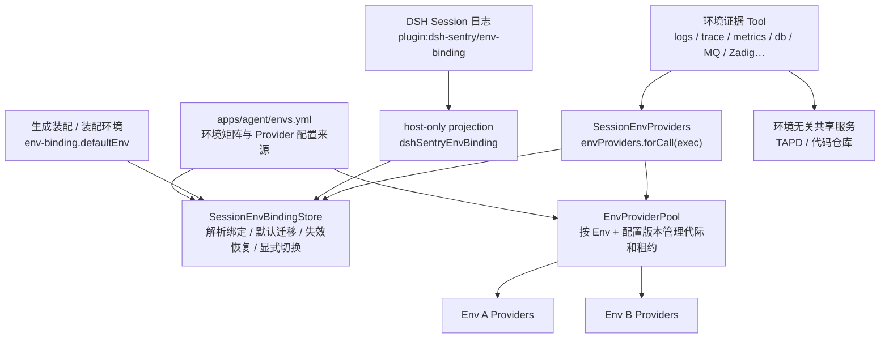
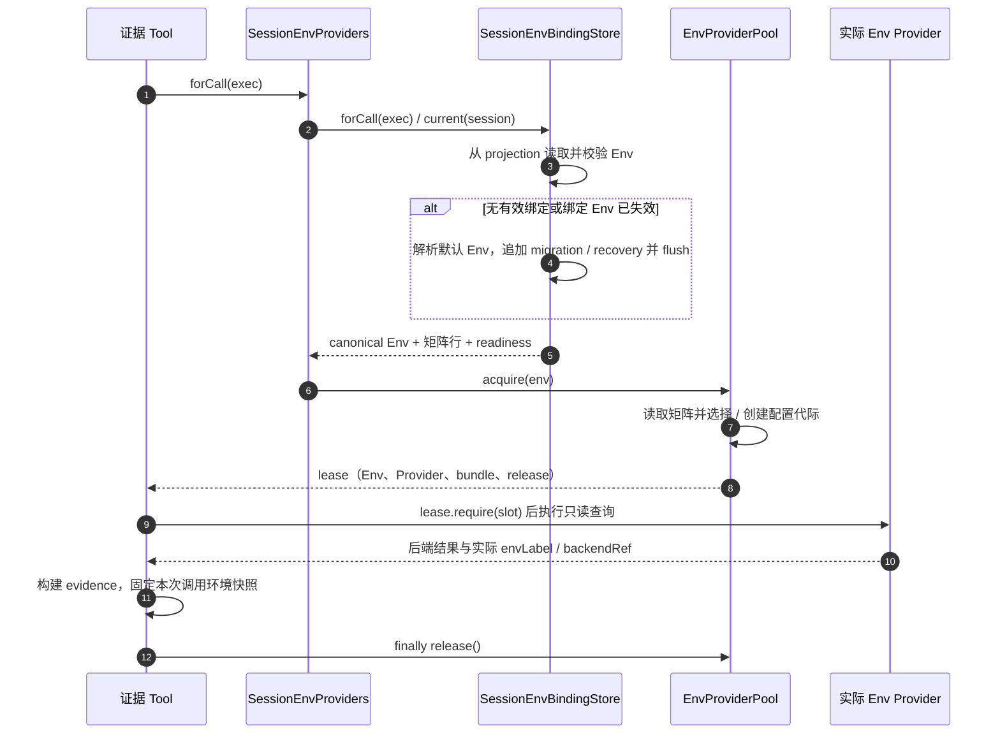

# Env / Session 架构：绑定、持久化与 Provider 池

> 状态：现行架构。Session 绑定、Provider 池与全部环境证据腿路由已实施，旧的全局 Provider 与写共享装配文件的切换路径已删除 · 2026-10-27
> 目标宿主：DSH `v0.2.1-rc.3`  
> 操作入口：[多环境切换指南](../guides/env-switching.md)

## 1. 核心语义

一个 DSH runtime 可以同时服务多个绑定到不同环境的 Session：

- S1 查询环境 A 时，S2 可以同时查询环境 B。
- S1 从 A 切到 B，只改变 S1 的后续调用，不影响 S2。
- 切换不重启 runtime，不新建、清空、fork 或压缩 Session。
- 进行中的调用继续使用开始时取得的 Provider；历史消息和历史 evidence 不改写。
- 同一环境的多个 Session 共享 Provider、连接和认证缓存，不按 Session 复制客户端。
- 进程重启并 resume 后，Session 从自己的持久化记录恢复环境，不要求调用方重传 Env。

“Session 与 Env 解耦”指**会话历史与后端运行配置解耦**，不表示调用不需要路由。runtime 没有唯一的全局 active Env，只有默认 Env、各 Session 的绑定，以及按 Env 加载的 Provider。

## 2. 状态归属

| 状态 | 权威来源 / 所有者 | 生命周期与约束 |
|---|---|---|
| 环境矩阵 | `apps/agent/envs.yml` | 声明 canonical 环境名、endpoint、数据源 uid 和 credential ref；唯一手工维护点 |
| 新 Session 默认 Env | 机器本地偏好键 `DSH_SENTRY_DEFAULT_ENV`（凭据库/环境变量）> 生成装配中的 `env-binding.defaultEnv`（装配环境） | 仅用于新 Session 初始化、无记录迁移和失效绑定恢复；不覆盖已有有效绑定；偏好键未设置或失效时使用装配环境 |
| Session 绑定事实 | Session 日志中的 `plugin:dsh-sentry/env-binding` | 追加式保存；最后一条 schema 有效记录生效；随 resume、fork 和导出日志携带 |
| Session 绑定读模型 | `dshSentryEnvBinding` projection | host-only，从完整 Session 日志折叠；是派生状态，不是第二份事实来源 |
| Provider 实例 | `EnvProviderPool` | 按 Env 和配置版本懒创建、复用、换代与释放 |
| 后端认证状态 | 各 Env 的 Provider | cookie、连接、过期时间和 timer 随对应 Provider 生命周期管理 |
| 单次调用环境 | `envProviders.forCall(exec)` 返回的 lease | 调用开始时固定 Env 和 Provider 代际，结束时释放租约 |
| 证据环境身份 | 单次 Tool 调用的局部快照 | 使用实际 Provider 的 `envLabel` / `backendRef`，不从共享装配文件冒充 |
| 凭据值 | `$DSH_HOME/.credentials.yaml` 或进程环境 | 不进入 Session 绑定记录；缺失时按腿降级 |
| 用户与 Session 的关系 | 外层 SDK / BFF | 负责鉴权和会话定位，不复制 Env 绑定事实 |

“当前环境”默认指**调用 Session 的绑定环境**。`use-env --current` 读取的是装配环境，不代表某个在线 Session 的实时绑定，也不覆盖有效的 `DSH_SENTRY_DEFAULT_ENV`。

## 3. 总体结构



三个机制各自承担一种职责：

1. **绑定服务**决定调用 Session 应使用哪个 Env，并负责持久化与恢复。
2. **Provider 池**决定该 Env 当前应使用哪一代客户端，并管理资源共享与释放。
3. **证据 Tool**只租用本次调用所需的 Provider，不持有全局环境或跨调用后端配置。

## 4. 单次证据调用



关键约束：

- Session 只从 `exec.agent?.session` 获取；无法解析时明确报错，不回退到“最后一个全局 Env”。
- 普通证据 Tool 不接受 `env` 参数，调用方不能绕过 Session 绑定临时选择后端。
- Tool 必须在成功或失败后都执行 `release()`；`lease.require(slot)` 会给出该腿不可用的具体原因。
- 调用开始后即使同一 Session 切到别的 Env，本次调用仍使用原 lease；下一次调用才使用新绑定。

## 5. 环境切换与持久化

### 5.1 绑定记录

`@dsh-sentry/env-binding` 拥有的记录类型为：

```text
plugin:dsh-sentry/env-binding
```

payload 固定为：

```ts
type EnvBindingRecord = {
  v: 1
  envName: string
  changedAt: string
  source: 'tool' | 'sdk' | 'default' | 'migration' | 'recovery'
}
```

约束：

- `envName` 只写矩阵中的 canonical 名称；别名在写入前解析。
- `changedAt` 仅用于审计和展示，生效顺序由 Session 日志顺序决定。
- payload 不包含 endpoint、credential ref、凭据值、cookie、Provider 配置或用户信息。
- 读回的 record data 一律按 `unknown` 经 schema 校验；无效记录不改变 projection。
- 不使用独立 KV、BFF 字段或业务内存 Map 复制绑定事实。

### 5.2 projection 读模型

`dshSentryEnvBinding` 是 `stateVersion: 1` 的 host-only projection：

- 折叠完整 Session 日志，包括 fork 的继承前缀；
- 只保存最后一条有效绑定及日志位置；
- 不在 projection 内读取矩阵、凭据或执行异步 I/O；
- 通过 `ctx.sessionProjections.stateOf()` 读取，不使用 deprecated 的历史事件扫描 API。

`current(session)` 是“解析并确保可用绑定”的操作，不只是纯读取：无记录时可能写 `migration`，绑定 Env 已失效时可能写 `recovery`。同一 Session 的恢复和显式切换串行执行，避免并发恢复覆盖显式切换；不同 Session 不加全局锁。

### 5.3 显式切换顺序

```text
解析 Session → 解析目标名称/别名并计算逐腿 readiness
→ 读取 previousEnv → append 绑定记录 → 确认 projection 已推进
→ await sessions.flush(session) → 返回真实 persisted
```

持久化语义必须区分：

- **append 成功**：新绑定已在本进程生效，后续调用使用新 Env。
- **flush 返回 true**：durability listener 已确认，结果返回 `persisted: true`。
- **flush 返回 false 或抛错**：绑定仍在本进程生效，但返回 `persisted: false`；错误时附 `persistenceError`，不能宣称已可靠落盘。
- **append 失败**：原绑定不变，不返回切换成功。

`sentry_env_switch` 的 `dryRun: true` 只解析目标和 readiness，不 append、不 flush、不改变绑定。

## 6. 默认环境与 Session 生命周期

| 场景 | 行为 |
|---|---|
| 新 Session，SDK 显式传 Env | 校验后写 `source: 'sdk'` |
| 新 Session，未传 Env | 绑定默认 Env，写 `source: 'default'` |
| 已有有效绑定 | 沿用最后一条有效记录；外层请求不得用默认 Env 覆盖 |
| 重启后 resume，有有效记录 | 从完整日志恢复，不要求重传 Env |
| 旧 Session 无记录 | 使用默认 Env，补写 `source: 'migration'` |
| 最后有效记录指向已移除 Env | 回退默认 Env，补写 `source: 'recovery'`，并报告 `recoveredFrom` |
| fork | 继承 fork 点的绑定；之后父子 Session 独立切换 |
| compact | 不改变原始日志和绑定，不从模型可见摘要推导 Env |
| JSONL 导出后恢复 | 记录保留则恢复；记录丢失则按无记录迁移，不伪造原环境 |
| 默认 Env 未配置或已移除 | 返回 `DEFAULT_ENV_INVALID`，不任意选择矩阵第一项（机器本地偏好键失效时先降级回装配默认值，仅当装配值也失效才走到这里） |

新 Session 默认 Env 的解析顺序：机器本地偏好键 `DSH_SENTRY_DEFAULT_ENV`（凭据库 `$DSH_HOME/.credentials.yaml` 或进程环境，值为 canonical 名或短名）优先；未设置或失效时使用装配环境 `env-binding.defaultEnv`。装配环境同时是启动期生成插件装配的锚点（bundle 按 `sentry.config.defaultEnv` 选择矩阵行），不是单纯的个人偏好备份。偏好键每次解析现读文件——偏好变更后，**下一个新 Session 即生效**，无需重启宿主，在线 Session 不受影响；偏好键因矩阵漂移失效时使用装配环境，不拦截 Session 初始化（默认环境是可用性配置，不是安全边界）。设置页展示解析结果，并可编辑/清除本机偏好键（经凭据 Remote set/unset 落盘），不写装配文件；凭据 Remote 只返回配置状态，具体环境名由宿主 `sentrySettings.getDefaultEnv` 这一非机密窄接口读取并回显。全局配置卡片另经 `getGlobalConfig` 展示代码检索根目录实际值，以及 Zadig token 等跨环境共享键的配置状态。

plugin record 的格式迁移是 best-effort。正常 resume 应恢复最后绑定；记录确实丢失时允许默认迁移，但必须通过 `source` 和返回状态保持可观测。

## 7. Provider 池与资源生命周期

Provider 配置由 `renderProviderEntries(row)` 从同一份 `envs.yml` 推导，不写入宿主全局装配。Pool 为每个 Env 创建隔离的 Cordis 上下文，并加载：

- DBX → `dbStore` / `cacheStore`；
- GreptimeDB → `logStore` / `callflowStore`；
- trace → `traceStore`；
- Prometheus → `metricsStore`；
- Alertmanager → `alertmanager`；
- RocketMQ → `mqStore`；
- Zadig → `zadig`；
- Kubernetes（经 kubernetes-mcp-server 网关桥接，按环境行 `kubernetes.context` 选集群）→ `kubernetes`。

生命周期规则：

1. **懒创建**：第一次 `acquire(env)` 才创建该 Env 的 Provider。
2. **按 Env 复用**：多个 Session 绑定同一 Env 时共享实例和认证状态。
3. **按调用租用**：`acquire` / `release` 界定活跃调用，防止释放仍在使用的客户端。
4. **按配置换代**：任一 Provider 配置变化会生成新的配置版本；后续调用使用新代际。
5. **旧代际排空**：旧代际标记 retired，活跃 lease 归零后释放其 Cordis fiber、连接和认证资源。
6. **按腿降级**：单腿加载失败进入 `unavailableLegs`，不阻断同 Env 的其他腿。
7. **runtime 关闭统一释放**：Pool dispose 时释放所有代际；运行中的宿主关闭不等同于一次普通配置换代。

Session 切换本身不销毁旧 Env Provider。旧 Env 可能仍被其他 Session 使用，也可能继续服务切换前已经开始的调用。

## 8. 证据身份与失败语义

- evidence 的 `env` 来自本次实际 lease / Provider，不从共享 patch、历史消息或切换目标推断。
- `backendRef` 与实际 Provider 在同一次调用中固定，不用一个 Env 的标签包装另一个 Env 的数据。
- 未知名称或别名拒绝切换并保留原绑定。
- 缺凭据只产生对应 `degradedLegs`，不拦截整个环境切换；readiness 是配置检查，不代表后端健康检查。
- Provider 创建或单腿查询失败时返回具体 Env、腿和原因，不借用其他 Session 或其他 Env 的可用 Provider。
- 后端暂时失败不自动切换到其他环境，避免把跨环境数据混入同一次调查。
- 持久化失败与 Provider 失败是独立维度：`persisted: false` 不表示查询失败，查询成功也不证明绑定已落盘。

## 9. 环境无关能力

TAPD 和代码仓库保留宿主级共享 Service，不进入每 Env Provider 池：

- TAPD 是平台级唯一背景证据来源；
- 代码仓库读取本机检出，发现配置为 `repos` / `baseDir` / `repoPath`；
- 机器本地 `DSH_SENTRY_CODE_BASE` 由代码仓库服务构造期解析，修改后重启宿主，不随 Session 环境切换，也不写入 Session 绑定。

环境无关服务的 evidence 标签不能用来推断某个环境证据 Tool 的 Session 路由。

## 10. 配置变更边界

| 改动 | 生效方式与影响 |
|---|---|
| 对话内 `sentry_env_switch` | 只重绑当前 Session；不写 patch/include，不依赖 watcher |
| `use-env <env> --profile sentry` | 更新启动装配和默认 Env；已有有效 Session 绑定不变 |
| `regenerate` | 重新生成装配并恢复 DP0 默认锚点；不是运行时切换命令 |
| 修改 `envs.yml` 中已绑定 Env 的名称有效性 | 下一次 `current()` 校验；失效绑定按默认 Env 执行 recovery |
| 修改某 Env 的 Provider 配置 | 下一次 `acquire()` 创建新配置代际；旧调用排空后释放 |
| 修改宿主 patch | 仍走 DSH watcher，这是宿主装配机制，不是 Session 路由机制 |
| 修改插件源码 | 重启宿主；link 依赖无需重装 |
| 修改机器本地代码根目录 | 重启代码仓库服务所在宿主，无需 regenerate |

## 11. 包职责与接入约束

| 包 | 职责 |
|---|---|
| `@dsh-sentry/env-matrix` | 环境名称与别名、矩阵读取、凭据 readiness、宿主装配与 Provider 配置推导 |
| `@dsh-sentry/env-binding` | record schema、projection、默认初始化、恢复、显式切换、flush 和 `forCall` |
| `@dsh-sentry/service-env-provider` | 组合绑定与 Pool，提供稳定的 `ctx.envProviders.forCall(exec)` |
| 各环境 Provider service | 认证、传输、后端响应校验和实际 `envLabel` / `backendRef` |
| 各证据 Tool | 获取 lease、选择所需 Store、构建 evidence、finally release |
| `@dsh-sentry/service-tapd` / `service-code-repository` | 环境无关共享能力 |

外层 SDK / BFF 可以调用同一个绑定服务初始化或显式切换，但必须遵守：

- `initialize()` 不覆盖已有绑定；
- resume 已有 Session 时不要求重传 Env；
- 修改已有 Session 的 Env 必须显式 `switch()`，不能在每次 prompt 中隐式重置；
- 产品数据库只保存用户、conversation 与 DSH Session 的关系，不维护第二份 Env 路由。

AsyncLocalStorage 可用于内部传递已确认的调用上下文，但不能作为绑定事实来源。

## 12. 验证与验收

```bash
pnpm test
pnpm typecheck
pnpm --filter @dsh-sentry/dev run probe:session-env
```

核心验收场景：

- S1=A、S2=B 并发查询，数据和 evidence 不串环境；
- S1 切到 B 只影响 S1 后续调用，S2 不变；
- A 查询进行中切换到 B，进行中结果仍标 A；
- 同 Env 的多个 Session 复用 Provider；
- fork 继承后独立，compact 不改变绑定；
- 完全退出并 resume 后恢复最后绑定；
- 无记录迁移、失效恢复、append / flush 失败语义可区分；
- 配置换代后旧调用完成并释放，runtime 关闭无悬挂资源；
- 会话切换不写共享 patch/include，不依赖 watcher。

相关测试位于 `packages/core/env-binding/tests/`、各环境证据 Tool 的 `session-env.test.ts`，以及 `apps/dev/src/probe-session-env.ts`。

## 13. 相关文档

| 主题 | 入口 |
|---|---|
| 对话内切换、CLI 默认环境与验证步骤 | [guides/env-switching.md](../guides/env-switching.md) |
| 系统分层与整体装配图 | [architecture/overview.md](overview.md) |
| DSH bundle / patch / watcher 机制 | [architecture/dsh-loading.md](dsh-loading.md) |
| 凭据引用与本地配置 | [guides/credentials.md](../guides/credentials.md) |
| 代码仓库根目录与运行时解析 | [guides/onboarding.md](../guides/onboarding.md) 第 2 步 |
